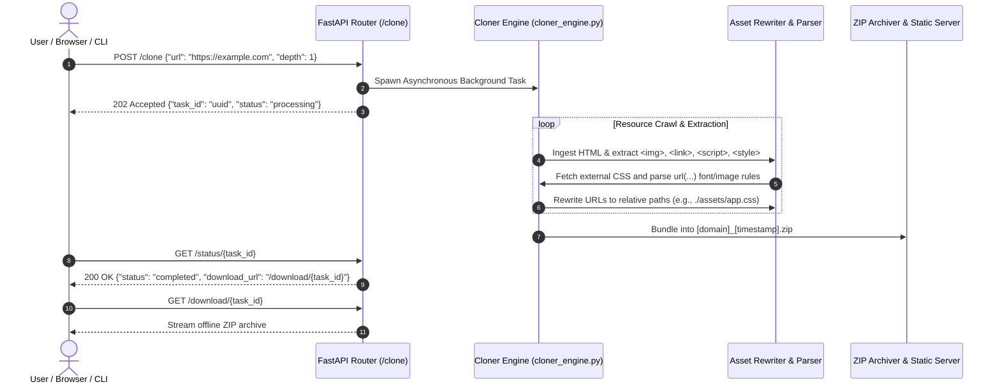

# WebCloner Service 🌐📦

> **Production-Grade Website Archival, Static Asset Bundling & Offline ZIP Export Service**  
> *Clone entire websites into self-contained, offline-browseable packages with rewritten relative links.*

[](https://fastapi.tiangolo.com)
[](https://python.org)
[](Dockerfile)
[](render.yaml)
[](LICENSE)

---

## 📌 Executive Summary

**WebCloner Service** is a high-performance web crawler and offline packager designed to create authentic, local-first offline mirrors of target websites. Unlike naive HTML scrapers, WebCloner performs deep recursive asset discovery—downloading external CSS stylesheets, JavaScript files, images, web fonts, and sub-resources—while rewriting all internal links and references so the resulting site opens directly from local storage with zero internet connectivity.

Each crawl is compressed into a clean, portable `.zip` archive ready for offline auditing, portfolio archiving, UI forensics, and disconnected client presentations.

---

## 🏛️ System Architecture



---

## ✨ Key Features & Capabilities

- 🕸️ **Comprehensive Asset Scraping**:
  - HTML source documents and inline templates.
  - Linked CSS stylesheets and `@import` rules.
  - JavaScript application bundles and external modules.
  - Media assets: WebP, PNG, JPG, SVG, GIF, Favicons.
  - Web fonts: WOFF2, WOFF, TTF, EOT referenced inside stylesheets.
- 🔄 **Intelligent Link Sanitization**:
  - Rewrites all absolute URLs pointing to the host domain into clean relative paths (`./assets/...`).
  - Preserves external out-of-scope links safely.
  - Strips dynamic tracking pixels and malicious telemetry scripts.
- 📦 **Automated ZIP Generation**: Zero-dependency packaging that creates an uncompressed or deflated ZIP bundle with a root `index.html` file.
- 🖥️ **Interactive Web HUD**: Clean, modern web frontend hosted on `/` with live download progress bars, task history, and instant download buttons.
- ⚡ **Asynchronous Background Processing**: Background tasks ensure the API responds instantly with a tracking ID without blocking the server.

---

## 📁 Repository Structure

```
web-cloner-service/
├── Dockerfile           # Multi-stage production container definition
├── render.yaml          # Blueprint deployment specification for Render
├── requirements.txt     # Python runtime dependencies (FastAPI, BeautifulSoup4, httpx)
├── main.py              # FastAPI application server, route handlers, and task manager
├── cloner_engine.py     # Core crawling, parsing, rewriting, and zip bundling engine
└── static/              # Web dashboard assets (HTML HUD, CSS styling, preview images)
```

---

## 🚀 Quick Start Guide

### 1. Local Python Setup

```bash
# Clone the repository
git clone https://github.com/SabarishR08/web-cloner-service.git
cd web-cloner-service

# Create and activate virtual environment
python -m venv venv
.\venv\Scripts\activate   # Windows
source venv/bin/activate  # Linux/macOS

# Install dependencies
pip install -r requirements.txt

# Run server with hot-reload
uvicorn main:app --host 0.0.0.0 --port 8000 --reload
```

Open `http://localhost:8000` in your browser to view the interactive Web UI.

---

### 2. Docker Deployment

```bash
# Build Docker image
docker build -t web-cloner-service:latest .

# Run container on port 8000
docker run -d -p 8000:8000 --name web-cloner web-cloner-service:latest
```

---

## 📡 REST API Reference

### 1. Initiate Clone Task
`POST /clone`

```bash
curl -X POST http://localhost:8000/clone \
  -H "Content-Type: application/json" \
  -d '{"url": "https://example.com", "depth": 1, "include_assets": true}'
```

**Response:**
```json
{
  "task_id": "7f8b3c40-1a2b-4c3d-8e4f-5a6b7c8d9e0f",
  "status": "processing",
  "message": "Cloning started for https://example.com"
}
```

### 2. Check Task Status
`GET /status/{task_id}`

```bash
curl http://localhost:8000/status/7f8b3c40-1a2b-4c3d-8e4f-5a6b7c8d9e0f
```

**Response:**
```json
{
  "task_id": "7f8b3c40-1a2b-4c3d-8e4f-5a6b7c8d9e0f",
  "status": "completed",
  "pages_crawled": 1,
  "assets_downloaded": 42,
  "download_url": "/download/7f8b3c40-1a2b-4c3d-8e4f-5a6b7c8d9e0f"
}
```

### 3. Download ZIP Archive
`GET /download/{task_id}`

```bash
curl -O http://localhost:8000/download/7f8b3c40-1a2b-4c3d-8e4f-5a6b7c8d9e0f
```

---

## 🛡️ License

This project is licensed under the [MIT License](LICENSE).
